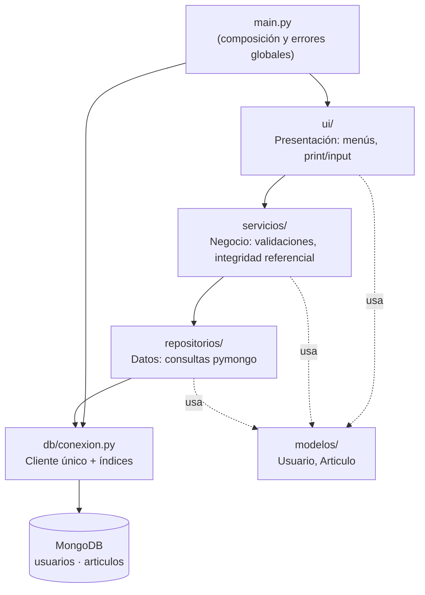

# Inventario con auditoría — Python + MongoDB

| | |
|---|---|
| **Autor** | Emilio Vega de Llergo Vargas |
| **Universidad** | Universidad Anáhuac Mayab |
| **Materia** | Bases de Datos Avanzadas |
| **Profesor** | Mtro. Fernando De Jesús Martínez Chacón |
| **Fecha** | 27 de octubre de 2026 |

---

## Índice

1. [Descripción del problema](#1-descripción-del-problema)
2. [Requisitos, instalación y ejecución](#2-requisitos-instalación-y-ejecución)
3. [Organización del código](#3-organización-del-código)
4. [Justificación del almacenamiento](#4-justificación-del-almacenamiento)
5. [Estrategia de claves](#5-estrategia-de-claves)
6. [Reglas de negocio y manejo de errores](#6-reglas-de-negocio-y-manejo-de-errores)
7. [Guía de pruebas](#7-guía-de-pruebas)
8. [Posibles mejoras](#8-posibles-mejoras)

---

## 1. Descripción del problema

Se necesita un prototipo de consola que permita administrar artículos de
inventario y **auditar qué usuario hizo la última modificación de cada uno**.
La información se organiza en dos colecciones de MongoDB:

| Colección | Campos |
|---|---|
| `usuarios` | `email` (único), `nombre`, `apellido`, `fecha_creado` |
| `articulos` | `nombre` (obligatorio), `descripcion`, `marca`, `usuario_modifico` (email de un usuario existente), `fecha_modificado` |

`fecha_modificado` es un campo adicional justificado por el propósito de
auditoría: saber *quién* modificó un artículo es incompleto sin saber
*cuándo*. Se actualiza en cada alta y en cada modificación.

Ejemplo de documentos almacenados:

```json
// usuarios
{ "_id": ObjectId("..."), "email": "ana.perez@ejemplo.com",
  "nombre": "Ana", "apellido": "Pérez",
  "fecha_creado": ISODate("2026-10-27T23:50:00Z") }

// articulos
{ "_id": ObjectId("6ae147870eb90e65409e0f6c"), "nombre": "Laptop",
  "descripcion": "14 pulgadas", "marca": "Dell",
  "usuario_modifico": "ana.perez@ejemplo.com",
  "fecha_modificado": ISODate("2026-10-27T23:55:00Z") }
```

---

## 2. Requisitos, instalación y ejecución

### Requisitos

- macOS (desarrollado y probado en macOS 26.6), Linux o Windows.
- Python 3.9 o superior.
- MongoDB Community Server en ejecución local (`mongodb://localhost:27017`); probado con 9.0.4.
- pymongo 4.18.3 (se instala con `requirements.txt`).
- Git.

### Instalación paso a paso

```bash
# 1. Clonar el repositorio
git clone git@github.com:emiliovegadellergo/mongo-python.git
cd mongo-python

# 2. Crear y activar el entorno virtual
python3 -m venv .venv
source .venv/bin/activate          # Windows: .venv\Scripts\activate

# 3. Instalar dependencias
pip install -r requirements.txt
pip install -r requirements-dev.txt   # opcional: flake8 para revisar estilo

# 4. Asegurar que MongoDB esté corriendo (macOS con Homebrew)
brew services start mongodb-community
```

### Ejecución

```bash
source .venv/bin/activate
python main.py
```

La conexión se configura en `config.py` y puede sobrescribirse con variables
de entorno sin tocar el código:

```bash
MONGO_URI="mongodb://otro-servidor:27017" DB_NAME="inventario_demo" python main.py
```

Si MongoDB no está disponible, el programa lo informa en una línea y termina
con código 1, sin traceback:

```
✗ No se pudo conectar a MongoDB en mongodb://localhost:27017 (tiempo límite: 3 s).
  Verifique que el servicio de MongoDB esté en ejecución (brew services start mongodb-community).
```

### Uso

```
=== INVENTARIO CON AUDITORÍA ===        === ARTÍCULOS ===
  1) Usuarios                             1) Crear
  2) Artículos                            2) Listar todos
  0) Salir                                3) Buscar por ID
                                          4) Actualizar
                                          5) Eliminar
                                          0) Volver
```

El submenú de usuarios es idéntico, con búsqueda por email. Al listar
artículos se muestra su ID para poder copiarlo en Buscar, Actualizar o
Eliminar.

---

## 3. Organización del código

```
mongo-python/
├── main.py                     # punto de entrada; arma las capas y captura errores globales
├── config.py                   # MONGO_URI y DB_NAME (override por variables de entorno)
├── db/
│   └── conexion.py             # cliente único, ping con timeout, creación de índices
├── modelos/
│   ├── usuario.py              # dataclass + to_dict / from_dict
│   └── articulo.py
├── repositorios/               # CAPA DE DATOS: única capa que importa pymongo
│   ├── errores.py              # traduce errores de pymongo a errores propios
│   ├── usuario_repositorio.py
│   └── articulo_repositorio.py
├── servicios/                  # CAPA DE NEGOCIO: validaciones y reglas; sin print/input
│   ├── excepciones.py
│   ├── usuario_servicio.py
│   └── articulo_servicio.py
├── ui/                         # CAPA DE PRESENTACIÓN: único lugar con print/input
│   ├── entradas.py
│   ├── menu_principal.py
│   ├── menu_usuarios.py
│   └── menu_articulos.py
├── pruebas/
│   └── generar_evidencias.py   # genera docs/evidencias.md
├── docs/
│   ├── evidencias.md
│   └── capturas/
├── requirements.txt
├── requirements-dev.txt
└── README.md
```

### Diagrama de capas



**Reglas de dependencia:** `ui → servicios → repositorios → db`. Ninguna
capa importa a una superior.

| Capa | Hace | No hace |
|---|---|---|
| `ui` | Pide datos, muestra resultados, traduce excepciones a mensajes | No importa pymongo, no valida reglas de negocio |
| `servicios` | Normaliza y valida, aplica reglas (email único, RESTRICT, responsable existente) | No usa `print`/`input`; lanza excepciones propias |
| `repositorios` | Ejecuta consultas y convierte documentos ↔ modelos | No usa `print`/`input`, no decide reglas |
| `db` | Crea el cliente, verifica la conexión, crea índices | No conoce las entidades |

### ¿Por qué se dividió así?

- **Responsabilidad única:** cada módulo tiene una sola razón para cambiar.
  Cambiar el texto de un menú no toca las reglas; cambiar una regla no toca
  las consultas.
- **Bajo acoplamiento:** las capas se comunican mediante modelos (`Usuario`,
  `Articulo`) y excepciones propias, nunca con tipos de pymongo. Por eso
  existe `repositorios/errores.py`: convierte `DuplicateKeyError` en
  `ClaveDuplicadaError` y cualquier `PyMongoError` en `ErrorPersistencia`,
  de modo que la UI puede manejar fallas de la base sin importar el driver.
- **Cambiar Mongo sin tocar la UI:** para migrar a SQLite o PostgreSQL basta
  con escribir nuevos repositorios con los mismos métodos y cambiar la
  construcción en `main.py`. Servicios y UI quedan intactos.
- **Inyección de dependencias:** cada repositorio recibe la base de datos en
  su constructor y cada servicio recibe sus repositorios. Así el script de
  pruebas usa la base `inventario_pruebas` sin modificar ningún módulo.
- **Reutilización:** como los servicios no hacen `print`/`input`, el script de
  evidencias los ejercita directamente, sin simular el teclado.

---

## 4. Justificación del almacenamiento

| Opción | Ventajas | Desventajas |
|---|---|---|
| **Memoria** (listas/dicts) | Cero configuración, muy rápido | Los datos se pierden al cerrar; inaceptable para auditoría |
| **Archivo JSON** | Simple, legible, sin servidor | Reescribe el archivo completo en cada cambio; sin índices ni unicidad; corrupción ante escrituras concurrentes o cortes |
| **SQLite** | Relacional, transacciones ACID, `FOREIGN KEY` nativas, un solo archivo | Esquema rígido (migraciones para cada campo nuevo); escritura concurrente limitada; no es el objetivo de la materia |
| **MongoDB** ✅ | Persistencia real, índices (incluido único), documentos flexibles que mapean directo a dicts de Python, escala horizontal, `BSON Date` nativo | Requiere un servidor; **no tiene llaves foráneas**; los `JOIN` (`$lookup`) son menos naturales |

Se eligió **MongoDB** porque el dominio es naturalmente documental (cada
artículo es autocontenido), los índices únicos resuelven la unicidad del
email a nivel motor y permite evolucionar el esquema (p. ej. agregar
`fecha_modificado`) sin migraciones.

### Integridad referencial sin llaves foráneas

MongoDB **no tiene llaves foráneas**: aceptaría sin quejarse un artículo cuyo
`usuario_modifico` no corresponde a nadie, o el borrado de un usuario que
todavía es referenciado. Por eso **la integridad referencial se implementa en
la capa de servicios**:

| Regla | En SQL se declararía | En este proyecto |
|---|---|---|
| El responsable debe existir | `FOREIGN KEY (usuario_modifico) REFERENCES usuarios(email)` | `ArticuloServicio.validar_responsable()` antes de cada create/update |
| No borrar usuarios referenciados | `... ON DELETE RESTRICT` | `UsuarioServicio.eliminar()` cuenta artículos con `contar_por_usuario()` y lanza `IntegridadReferencialError` |
| Email único | `email VARCHAR(255) UNIQUE` | Verificación en el servicio + índice único `ux_usuarios_email` |

En SQL el esquema equivalente sería:

```sql
CREATE TABLE usuarios (
    email        VARCHAR(255) PRIMARY KEY,
    nombre       VARCHAR(100),
    apellido     VARCHAR(100),
    fecha_creado TIMESTAMP NOT NULL
);

CREATE TABLE articulos (
    id               INTEGER PRIMARY KEY,
    nombre           VARCHAR(200) NOT NULL CHECK (TRIM(nombre) <> ''),
    descripcion      TEXT,
    marca            VARCHAR(100),
    usuario_modifico VARCHAR(255) NOT NULL,
    fecha_modificado TIMESTAMP NOT NULL,
    FOREIGN KEY (usuario_modifico) REFERENCES usuarios(email)
        ON DELETE RESTRICT
        ON UPDATE RESTRICT
);
```

La diferencia clave: en SQL el **motor** garantiza la regla para cualquier
cliente que se conecte; aquí la garantía depende de que todas las escrituras
pasen por la capa de servicios. Es un compromiso aceptable para un prototipo
con un solo punto de acceso, y se discute en [Posibles mejoras](#8-posibles-mejoras).

---

## 5. Estrategia de claves

1. **Clave del usuario: email como clave de negocio.** Es lo que el usuario
   conoce y escribe, y es naturalmente único. Se normaliza con
   `strip().lower()` para que `Ana@X.com ` y `ana@x.com` no se consideren
   distintos, se valida con un regex básico (`algo@algo.dominio`, sin
   espacios) y está respaldado por un índice único. El `_id` (ObjectId) se
   conserva como clave técnica interna de Mongo.
2. **El email es inmutable.** En Actualizar solo se modifican nombre y
   apellido. Es la clave que referencian los artículos en `usuario_modifico`;
   cambiarla dejaría artículos apuntando a un email inexistente y rompería la
   trazabilidad (en SQL equivaldría a `ON UPDATE RESTRICT`).
3. **Clave del artículo: ObjectId.** Los artículos no tienen un identificador
   natural (puede haber dos "Laptop Dell"). El ObjectId se genera sin
   coordinación, es único y además codifica su fecha de creación. Se muestra
   al listar para poder copiarlo, y antes de consultar se valida con
   `ObjectId.is_valid` (24 caracteres hexadecimales) para dar un mensaje claro
   en lugar de una excepción de `bson`.
4. **Borrado de usuario con artículos: RESTRICT.** Se rechaza y se informa
   cuántos artículos lo referencian. En un sistema de auditoría, `CASCADE`
   destruiría justamente el historial que se quiere conservar, y `SET NULL`
   dejaría artículos sin responsable.
5. **Email duplicado: doble barrera.**
   - *Servicio:* `existe(email)` antes de insertar → mensaje claro.
   - *Índice único:* si dos procesos pasan la verificación al mismo tiempo
     (condición de carrera *check-then-act*), el índice rechaza el segundo
     insert; el repositorio traduce `DuplicateKeyError` y el servicio lo
     convierte en el mismo `EmailDuplicadoError`. Durante el desarrollo se
     comprobó esta segunda barrera simulando la carrera (desactivando la
     verificación del servicio): el índice rechazó el duplicado.
6. **Fechas: `datetime` nativo (BSON Date) en UTC.** Se guardan con
   `datetime.now(timezone.utc)` y el cliente se crea con `tz_aware=True`. Un
   tipo fecha nativo permite ordenar y filtrar por rango en el servidor (con
   texto `"2026-10-27"` no se podría usar `$gte` de forma fiable). En pantalla
   se muestran como `YYYY-MM-DD` **convertidas a la zona horaria local**, para
   que un artículo creado a las 19:00 en México no aparezca con la fecha del
   día siguiente (UTC).
7. **Índice en `articulos.usuario_modifico`.** La verificación RESTRICT
   ejecuta `count_documents({"usuario_modifico": email})` en cada intento de
   borrado. Sin índice sería un *collection scan* (O(n)); con el índice
   `ix_articulos_usuario_modifico` es una búsqueda en árbol B. Se comprobó con
   `explain()` que el plan ganador usa el índice.

Los índices se crean al arrancar en `db/conexion.py` con `create_index`, que
es idempotente.

---

## 6. Reglas de negocio y manejo de errores

### Reglas de negocio

| Regla | Dónde |
|---|---|
| Email obligatorio, normalizado y con formato válido | `usuario_servicio.validar_email` |
| Email único | `UsuarioServicio.crear` + índice único |
| Email inmutable; Enter en blanco conserva nombre/apellido | `UsuarioServicio.actualizar` |
| No borrar usuario con artículos (RESTRICT) | `UsuarioServicio.eliminar` |
| Nombre de artículo obligatorio, ni vacío ni solo espacios (tampoco tras actualizar) | `articulo_servicio.validar_nombre` |
| El responsable debe existir; se verifica en cuanto se escribe el email, antes de pedir los demás campos | `ArticuloServicio.validar_responsable` |
| En Actualizar artículo, Enter en blanco conserva cada campo | `ArticuloServicio.actualizar` (`None` = conservar) |
| Cada create/update registra `usuario_modifico` y `fecha_modificado` | `ArticuloServicio.crear` / `actualizar` |
| Eliminar pide confirmación s/n | `ui/menu_*.py` |

Nombre y apellido del usuario son opcionales, ya que la especificación solo
exige obligatoriedad para el nombre del artículo.

### Jerarquía de excepciones

```
InventarioError                  (servicios/excepciones.py)
├── ValidacionError              formato o dato obligatorio
├── EmailDuplicadoError
├── UsuarioNoEncontradoError
├── ArticuloNoEncontradoError
└── IntegridadReferencialError   incluye .referencias (cuántos artículos)

ErrorPersistencia                (repositorios/errores.py)
└── ClaveDuplicadaError          violación de índice único

ErrorConexion                    (db/conexion.py) Mongo no responde al arrancar
```

### Robustez: el programa nunca se cierra por entradas inválidas

| Situación | Manejo |
|---|---|
| Opción no numérica o fuera de rango | `leer_opcion` repite la pregunta |
| Campo obligatorio vacío | `leer_texto_obligatorio` repite la pregunta |
| Respuesta distinta de s/n | `confirmar` repite la pregunta |
| ObjectId mal formado | `ValidacionError` antes de consultar |
| Cualquier error de negocio | `ejecutar_accion` lo muestra y vuelve al menú |
| `PyMongoError` durante una operación | El repositorio lo traduce a `ErrorPersistencia`; `ejecutar_accion` lo muestra y vuelve al menú |
| MongoDB caído al arrancar | Ping con timeout de 3 s → `ErrorConexion` → mensaje y salida con código 1 |
| `Ctrl+C` (`KeyboardInterrupt`) o `Ctrl+D` (`EOFError`) | `main.py` muestra "Programa interrumpido por el usuario" y cierra la conexión |

---

## 7. Guía de pruebas

### Script de evidencias

```bash
source .venv/bin/activate
python pruebas/generar_evidencias.py
```

El script usa la **capa de servicios** (no la UI) sobre una base separada,
`inventario_pruebas`, que se borra al iniciar y al terminar, por lo que nunca
toca los datos reales. Escribe [`docs/evidencias.md`](docs/evidencias.md) y
termina con código 0 solo si todos los casos se comportan como se esperaba.

Casos cubiertos (14):

- **Éxito (8):** crear, buscar, actualizar y eliminar usuario; crear, buscar,
  actualizar y eliminar artículo. Cada uno verifica el estado guardado, no
  solo la ausencia de errores (p. ej. que Actualizar conserve los campos no
  modificados y avance `fecha_modificado`).
- **Fallo controlado (6):** artículo con usuario inexistente, nombre vacío,
  nombre de solo espacios, email duplicado (en otra capitalización), borrar
  usuario con artículos (RESTRICT) y buscar artículo con ID mal formado.

Resultado actual: **14 de 14 casos como se esperaba**. Ver
[`docs/evidencias.md`](docs/evidencias.md).

### Revisión de estilo

```bash
flake8 --exclude .venv .    # 0 errores
```

### Capturas de ejecución

> Las imágenes se agregan en `docs/capturas/`.

**Menú principal**


**Crear usuario**


**Listar usuarios**


**Crear artículo (responsable verificado)**


**Listar artículos con su ID**


**Actualizar artículo (Enter conserva valores)**


**Rechazo: artículo con usuario inexistente**


**Rechazo: borrar usuario con artículos (RESTRICT)**


**Rechazo: ID mal formado y opción inválida**


**Ejecución del script de evidencias**


---

## 8. Posibles mejoras

### Validación de esquema con `$jsonSchema`

Hoy las reglas viven solo en Python. MongoDB permite declarar un validador
en la colección para que el **motor** rechace documentos inválidos aunque
alguien escriba desde `mongosh` u otra aplicación:

```javascript
db.runCommand({
  collMod: "articulos",
  validator: { $jsonSchema: {
    bsonType: "object",
    required: ["nombre", "usuario_modifico", "fecha_modificado"],
    properties: {
      nombre:           { bsonType: "string", pattern: "\\S" },
      usuario_modifico: { bsonType: "string" },
      fecha_modificado: { bsonType: "date" }
    }
  }},
  validationLevel: "strict"
})
```

`$jsonSchema` valida forma y tipos, pero **no** puede comprobar que el email
exista en otra colección; la integridad referencial seguiría en servicios.

### Transacciones

Las verificaciones de integridad son *check-then-act*: entre comprobar que
un usuario no tiene artículos y borrarlo, otro proceso podría asignarle uno
(y lo mismo al crear un artículo mientras su responsable es borrado). Con un
*replica set*, MongoDB ofrece transacciones multi-documento
(`with cliente.start_session() as s: s.with_transaction(...)`) que harían
ambas operaciones atómicas. El email duplicado no necesita esto porque ya lo
cubre el índice único.

### Historial completo de auditoría

El modelo actual guarda solo la **última** modificación. Una colección
`historial_articulos` con un documento por cambio (quién, cuándo, valores
anteriores y nuevos) permitiría reconstruir toda la vida de un artículo;
ahí el RESTRICT cobra aún más sentido.

### Paginación

`listar_todos()` carga toda la colección en memoria. Con `limit()` y
paginación por cursor (`{"_id": {"$gt": ultimo_id}}`) en lugar de `skip()`,
cuyo costo crece con el desplazamiento, cada página costaría lo mismo sin
importar en cuál se esté.

### ¿Qué cambiaría con 10 millones de artículos?

- **Paginación obligatoria** en el listado, por cursor como se describió;
  imprimir 10 M de filas en consola no tiene sentido.
- **Búsquedas por nombre/marca:** agregar índices (`nombre`, o un índice de
  texto / Atlas Search) en lugar de recorrer la colección.
- **Índice compuesto** `{usuario_modifico: 1, fecha_modificado: -1}` para
  consultas de auditoría como "¿qué modificó Ana este mes?"; también sirve a
  la verificación RESTRICT por ser prefijo.
- **RESTRICT más barato:** `count_documents(..., limit=1)` o `find_one` basta
  para saber si hay *al menos* una referencia; contar todas solo se haría
  para el mensaje.
- **Proyecciones:** pedir solo los campos que se muestran.
- **Escalamiento:** *replica set* para alta disponibilidad y lecturas en
  secundarios; *sharding* por `_id` con hash si el volumen de escritura
  supera un solo servidor.
- **Historial separado** con TTL o archivado para que la colección de
  trabajo no crezca sin límite.
